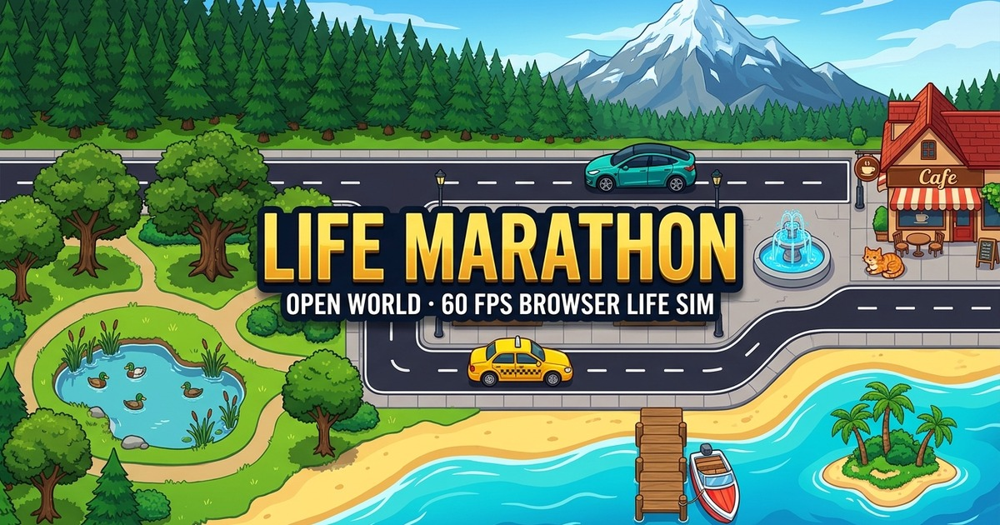

# 🌍 Life Marathon: Open World / Yaşam Maratonu (EN & TR)



[](https://berkehanbudak1-byte.github.io/yasam-maratonu/dunya.html)
[](https://berkehanbudak1-byte.github.io/yasam-maratonu/dunya.html)
[](https://berkehanbudak1-byte.github.io/yasam-maratonu/dunya.html)

**Play instantly in your browser — no download, no login, zero external assets, 100% vanilla HTML5 Canvas & Web Audio API.**

- 🎮 **Play Open World Edition (v10.1 — EN / TR auto-detect):** https://berkehanbudak1-byte.github.io/yasam-maratonu/dunya.html
- 🏔️ **Classic Godot 4.3 3D WebAssembly Edition:** https://berkehanbudak1-byte.github.io/yasam-maratonu/

---

## ✨ What's Inside `dunya.html` (Open World v10.1)

- **🗺️ 6 Seamless Biomes (`3600×2800` World):** City Center, Green Park & Duck Pond, Northern Forest, Snowy Peak, Golden Beach, and a hidden **Treasure Island** across the ocean.
- **🤖 Autonomous Life Swarm AI (`[O]`):** Toggle Auto-Pilot and watch a multi-agent AI take care of survival needs, garden harvests, gourmet cooking, career shifts, bank savings, and scenic exploration — take manual control back anytime!
- **🚗 Living City & Real-Life Mechanics:** Smart city traffic with honking cars & hazard lights, hail passing **Yellow Taxis**, ride **4 Fast-Travel Bus Stops**, drive your own **EV Car** (with battery & charging station), **Bicycle**, or **Speedboat** (`[U]`), open a **City Bank** account (8%–12% daily compound interest + utility bills), and stay dry with an auto-opening **Rainbow Umbrella** in storms.
- **🐱 Interactive Animals & Wildlife:** Pet and feed 6 friendly street cats & dogs, bond with forest deer & rabbits, and toss treats to pond ducks — all with procedural animal sounds.
- **🏡 Walkable Home Interior, Garden & Gourmet Kitchen:** Step inside your customizable home (furniture, PC remote work, guitar, TV, cooking stove), grow 3 crops in your 6-plot garden, cook gourmet meals, buy & run your own **Cafe (Barista Rush mini-game)**, earn **University Diplomas**, and snap **Scenic Photos (`[F]`)**.
- **🎵 Procedural Web Audio Music & Radio Studio (`[N]`):** 8 composed multi-instrument tracks + continuous biome ambience (ocean surf, rain, forest breeze, birds, night crickets) synthesized live in Web Audio API.
- **🔒 Security Hardened:** Strict CSP, zero `innerHTML`/`eval` sinks, safe DOM factory, and automated CI unit tests (`node --test tests/security.test.js`).
- **🌐 Bilingual (EN / TR):** Automatically detects browser language (`EN` for global players, `TR` for Turkish players) with one-click live switching on the title screen or in `[H]` Help.

---

## 🇹🇷 Türkçe Özet

**Yaşam Maratonu: Büyük Dünya (v10.1)** — Tarayıcıda kurulumsuz, 60 FPS çalışan açık dünya yaşam simülatörü:
- 6 biyom + tekneyle gidilen Hazine Adası, gezilebilir ev içi, 6 parsellik bahçe, gurme mutfak, Üniversite diplomaları, Kafe sahipliği ve Barista/Kurye mini-oyunları.
- Korna çalan akıllı şehir trafiği, yoldan çevrilebilen sarı taksi, etkileşimli sokak kedileri/köpekleri, orman hayvanları, gölet ördekleri, Banka & EV şarj istasyonu.
- `[O]` Otonom Yaşam Swarm (Oto-Pilot), `[N]` prosedürel Web Audio Müzik & Radyo Stüdyosu ve tek tıkla **TR / EN** dil değişimi.

---

## 🛠️ Local Development & Testing

```bash
# Syntax check & security test suite (same as GitHub Actions CI)
for f in dunya/src/*.js tests/*.js; do node --check "$f"; done
node --test tests/security.test.js

# Serve locally
python3 -m http.server 8081
```
